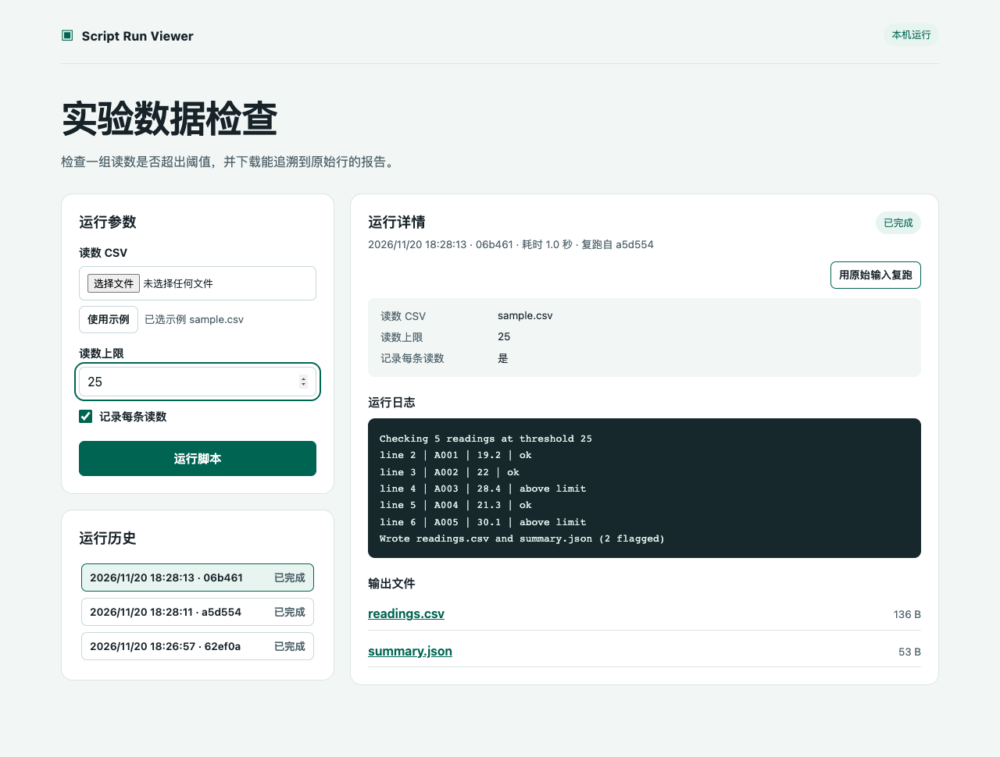

# Script Run Viewer

把本地脚本变成一个可以填参数、看日志、下载结果和复跑的网页。这个 Codex Skill 会先读脚本和 CLI，再生成小型本机查看器。项目里的脚本继续用原来的命令行运行。

Turn a trusted local script into a browser tool with a generated form, live logs, downloadable outputs, and replayable runs. Codex reads the CLI and adapts a small local viewer around it. The viewer itself uses only the Python standard library.



## 安装到 Codex · Install in Codex

在 macOS / Linux 上使用 Python 3.9+。在终端安装到 Codex 的用户级 Skills 目录。

```sh
mkdir -p ~/.agents/skills
git clone https://github.com/flova-su/script-run-viewer.git ~/.agents/skills/script-run-viewer
```

在包含目标脚本的项目里打开一个 Codex 会话，输入下面这句话，并将 `analysis.py` 换成自己的脚本路径。

> 用 `$script-run-viewer` 把 `analysis.py` 做成本机网页。保留当前 CLI，让我能填写参数、查看实时日志和下载结果。用项目里的样例验证一次。

Or ask Codex: “Use `$script-run-viewer` to wrap `analysis.py` in a local web UI and verify it with a sample input.” [Codex skill installation](https://developers.openai.com/api/reference/cli)

## 先试示例 · Try the demo

示例用五条合成读数演示阈值检查。在一个新的目录生成并启动查看器。

```sh
python3 ~/.agents/skills/script-run-viewer/scripts/scaffold.py ./script-viewer-demo
python3 ./script-viewer-demo/viewer.py
```

打开 [本机查看器](http://127.0.0.1:8790)，点击「使用示例」和「运行脚本」。默认阈值下，两条读数超限。下载 `summary.json` 或 `readings.csv`，再点「用原始输入复跑」。如果电脑上的 8790 端口已经被占用，启动时加 `--port 8791`。

## 接自己的脚本 · Adapt a script

- 在 `viewer.json` 定义原有 CLI、运行目录和输入字段。表单支持文件、文本、数字、下拉选项和开关。
- 让脚本或轻量包装器把产物写入本次运行的输出目录。调用可用原来的 Python、R、Node 或 shell 环境，并需要项目本身的依赖。
- 每次运行保存实际参数、输入文件副本和选定源码的指纹。复跑会核对这些记录。第三方库、外部数据和服务可能变化。

查看 [配置字段和参数类型](references/manifest.md)。在同一个生成目录启动一个查看器，一次运行一个任务。当前界面为中文，上传上限为每个文件 4 MiB、整个请求 24 MiB。查看器仅监听本机，以本机用户身份运行可信代码。输入、日志和产物保存在本地 `.script-viewer/runs/`。

欢迎通过 [GitHub Issues](https://github.com/flova-su/script-run-viewer/issues) 分享想接入的 CLI、输入格式和理想输出。用脱敏命令和合成样例即可。

MIT License.
